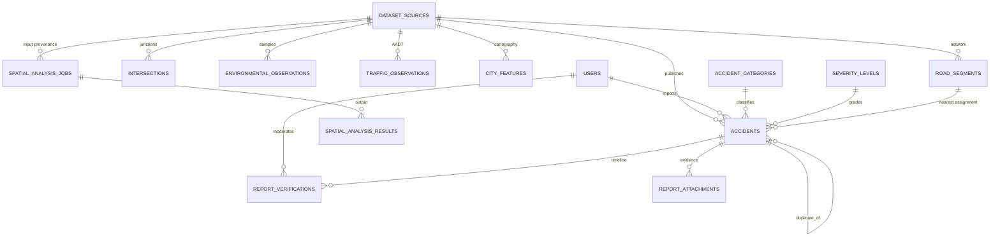

# Architecture notes — Urban Accident Intelligence

## 1. Context and constraints

The deliverable must demonstrate a scientifically defensible Web-GIS workflow: crowdsourced reporting → moderation → spatiotemporal analysis → transparent risk screening. The runtime provided for this deployment is **Next.js (App Router) + PostgreSQL via Drizzle ORM**, so the reference implementation uses:

- **Next.js / React / TypeScript (strict)** for the interface, server rendering and REST handlers;
- **MapLibre GL JS** for the map (custom generated vector cartography, no third-party basemap dependency);
- **Apache ECharts** for analytical plots (tree-shaken modules);
- **PostgreSQL** as the spatial store (GeoJSON in `jsonb` + indexed coordinate columns);
- a **framework-free GIS/statistics core** in TypeScript (`src/lib/geo.ts`, `stats.ts`, `analysis.ts`, `risk.ts`) that is unit-tested and portable.

The target stack in the brief (SvelteKit + FastAPI + PostGIS + GeoPandas/PySAL) is supported by the same contracts: analytical functions have pure inputs/outputs, the API is GeoJSON-based, and the schema has a documented PostGIS migration path. Nothing in the scientific core depends on React or Next.js.

## 2. Entity–relationship model



### Key fields

- `accidents`: `public_id`, `dataset_id`, `reporter_id`, `status` (`reported|verified|rejected|duplicate`), `category_code`, `severity_code`, `occurred_at`, `reported_at`, `lat/lng`, `original_lat/lng`, `positional_uncertainty_m`, `location_method`, `geom` (GeoJSON Point), `district`, `road_segment_id`, `vehicles`, `casualties`, `fatalities`, `emergency_services`, `description`, `weather`, `road_surface`, `lighting`, `hour`, `dow`, `month`, `duplicate_of_id`, `duplicate_score`, `quality_flags`, `verified_at/by`.
- `road_segments`: `id`, `road_class` (`ring|arterial|secondary|local`), `lanes`, `speed_limit_kmh`, `surface`, `is_lit`, `district`, `length_m`, endpoint coordinates and bbox, `aadt`, `heavy_vehicle_pct`, `geometry` (GeoJSON LineString).
- `environmental_observations`: district, coordinates, `observed_at`, `daypart`, `condition`, `precipitation_mm`, `temperature_c`, `visibility_m`, `road_surface`, `lighting`.
- `traffic_observations`: `segment_id`, `daypart`, `observed_at`, `aadt`, `heavy_vehicle_pct`.
- `report_verifications`: append-only `action`, `previous_status`, `new_status`, `notes`, verifier, timestamp.
- `spatial_analysis_jobs`: `kind`, `params`, filters + sample size, duration, feature count, summary (assumptions/limitations), actor.
- `audit_logs`: actor, action, entity type/id, JSON detail, timestamp.

### Constraints and indexes

- Unique: `accidents.public_id`, `dataset_sources.slug`, `users.email`, PKs on vocabularies.
- Foreign keys: accidents → categories/severity/dataset/users/segment; attachments & verifications cascade on accident deletion; results cascade on job deletion.
- Indexes: `occurred_at`, `status`, `category_code`, `severity_code`, `lat`, `lng`, `road_segment_id`, `district`, `dataset_id`; network indexes on `district` and `road_class`; observations indexed by district/segment/time; audit by time.
- UTC everywhere (`timestamptz`); hour/day-of-week/month denormalised at write time for cheap indexed aggregation.
- Original submitted coordinates are preserved separately from validated geometry.

### Geometry strategy and PostGIS migration

GeoJSON is persisted in `jsonb`; metric calculations use a local equidistant projection (`makeProjection`, origin at the study-area centre). Measured planar error against geodesic distance is ≈0.2 % at 8 km — below crowdsourced positional error but disclosed in the documentation and reflected in the tests.

PostGIS migration path:

1. `CREATE EXTENSION postgis;`
2. Add `geom_27700 geometry(Point, 27700)` to accidents and `geom_27700 geometry(LineString, 27700)` to road_segments.
3. Backfill with `ST_Transform(ST_SetSRID(ST_GeomFromGeoJSON(geom), 4326), 27700)`.
4. Add GiST indexes; create a materialised nearest-segment assignment table.
5. Replace `pointToSegment` distance-band search with `ST_DWithin`/window functions and the Gi* neighbourhood query with a spatial self-join.
6. Keep `src/lib/stats.ts` for statistical inference and validation; it is independent of the geometry source.

## 3. Runtime data flow

```
Browser (React client components)
  │  fetch /api/*
  ▼
Route handlers (validation, roles, audit, job persistence)
  │  parseFilters → Drizzle SQL predicate
  ▼
PostgreSQL ── filtered accident records + static metadata (cached per process)
  │
  ▼
Pure analysis modules (geo/stats/analysis/risk)
  │
  ▼
GeoJSON FeatureCollections + metrics + assumptions + limitations + tables
  │
  ▼
MapLibre layers · ECharts · tables · exports
```

- Expensive operations (KDE raster, Gi*, DBSCAN, risk) execute server-side and are persisted as **spatial_analysis_jobs** with parameters and filters. The UI reports feature counts, durations and truncation.
- Interaction is linked: filter state drives the accidents GeoJSON, statistics and analysis call; map viewport changes trigger a debounced extent statistics call; chart clicks mutate the shared filter state.

## 4. Security and integrity

- Role checks are enforced server-side in route handlers and page-level guards (`src/lib/auth.ts`).
- Passwords: scrypt with per-user salt; session cookies HMAC-SHA256 signed, HttpOnly, SameSite=Lax, 12 h TTL.
- All report inputs are schema-validated (zod) with geographic and temporal bounds; attachments restricted to PNG/JPEG/WebP ≤ 1 MB and never exposed in public responses.
- Moderation and analysis actions write to `report_verifications` and `audit_logs`; nothing is hard-deleted.
- Public tracking omits reporter identity and contact fields by construction.
- No secrets in source: `DATABASE_URL` and `SESSION_SECRET` are read from the environment (`.env.example` provided).

## 5. Seeding and reproducibility

`src/lib/seed/city.ts` builds the network (harmonic-warped grid, ring road, parkways, districts, river, lake, parks); `generate.ts` samples incidents under a scenario, with severity driven by speed, lighting, wetness and road-user type, then injects data-quality defects. `run.ts` writes everything transactionally in batches and records the seed/scenario in `dataset_sources`.

Runtime bootstrap (`src/lib/bootstrap.ts`) applies idempotent DDL, takes a Postgres advisory lock and seeds only when no dataset exists — enabling a clean `git clone → npm install → build → start` experience.

## 6. Known gaps / future work

- PostGIS geometry columns and GiST indexes (see migration path).
- Asynchronous worker queue for large analyses (currently request-scoped, bounded payloads).
- Calibrated probabilistic models (e.g. hierarchical Poisson, graph neural networks) — deliberately not a dependency; the analyser interface would accept an alternative scoring provider.
- Spatial cross-validation and predictive benchmarking against held-out synthetic outcomes.
- FDR-adjusted Gi* output and sensitivity analysis over bandwidths.
- OIDC/SSO, rate limiting, and observability (structured logs, metrics) for production.
