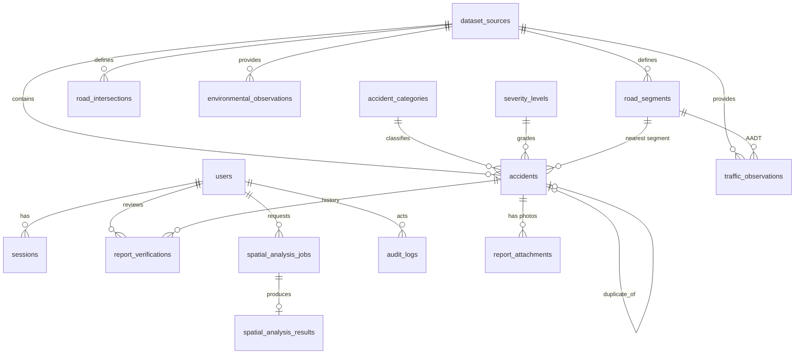

# Urban Accident Intelligence

A crowdsourced Web-GIS platform for road-accident reporting, spatiotemporal accident analysis and urban road-safety intelligence.

> **Synthetic demonstration.** Every accident, weather and traffic record shipped with this repository is generated by a seeded simulator for a fictional city (*Synthetic City SYN-01*). Nothing here is a real-world finding. Statistics illustrate the methods; they do not describe any real road network.

The platform lets citizens report incidents on a map, lets administrators verify, reject, de-duplicate and correct them, and provides analytical workspaces (KDE, Getis-Ord Gi\*, DBSCAN, segment aggregation, environmental comparison and a transparent risk index). Every analytical output states what it represents, which assumptions were checked, and what it cannot tell you.

---

## Contents

1. [Architecture and stack decisions](#architecture-and-stack-decisions)
2. [Quick start](#quick-start)
3. [Configuration](#configuration)
4. [Product modules](#product-modules)
5. [Data model (entity–relationship)](#data-model-entityrelationship)
6. [Spatial design](#spatial-design)
7. [Analytical methods and their constraints](#analytical-methods-and-their-constraints)
8. [Synthetic data generator](#synthetic-data-generator)
9. [REST API](#rest-api)
10. [Testing and validation](#testing-and-validation)
11. [Security and privacy](#security-and-privacy)
12. [Known limitations and roadmap](#known-limitations-and-roadmap)

---

## Architecture and stack decisions

The brief asked for SvelteKit, FastAPI, PostGIS and GeoPandas. This workspace is a Next.js + Drizzle + PostgreSQL environment, and its preview pipeline runs that runtime. Rather than split the system across an unsupported second runtime, the platform is built as a single, modular TypeScript application with the same responsibilities separated cleanly:

| Concern | Brief | Implemented | Why |
| --- | --- | --- | --- |
| Frontend | SvelteKit | Next.js 16 App Router, React 19 | Runtime supported by the preview environment |
| Map | MapLibre GL JS | MapLibre GL JS 5 (native clustering, heatmap, data-driven styling) | As specified |
| Charts | Apache ECharts | ECharts 5 (lazy-loaded, linked to filters) | As specified |
| Icons / styling | Lucide, Tailwind | Lucide React, Tailwind CSS 4 with design tokens | As specified |
| Backend | FastAPI + Pydantic | Route handlers + Zod schemas, single table-driven router | Same contract discipline (typed validation, OpenAPI) in one runtime |
| ORM | SQLAlchemy | Drizzle ORM | Typed SQL in the existing stack |
| Spatial DB | PostgreSQL + PostGIS | PostgreSQL 16 with **`cube` + `earthdistance`** (GiST-indexed great-circle queries) | PostGIS is not installable in the sandbox; these contrib modules ship with PostgreSQL and provide indexed spatial search |
| Projected CRS | EPSG:32633 | EPSG:32633 (UTM 33N) via proj4 for every metric calculation | As specified |
| Geoprocessing | GeoPandas, Shapely, PySAL | Pure TypeScript implementations (KDE, Gi\*, DBSCAN, Moran's I, snapping) with unit tests | Keeps every approximation inspectable and testable in one language |
| Migrations | Alembic | Drizzle Kit migrations in `drizzle/`, applied automatically at startup | Equivalent versioned, reversible-by-review migration history |
| Containers | Docker Compose | `docker-compose.yml` (PostgreSQL + app) and `Dockerfile` | As specified; not executed in this sandbox (Docker unavailable) |

Layering (no circular product logic):

```
src/app/                 pages (client components) and the catch-all API route
src/components/          map, charts, filters, UI primitives, client hooks
src/lib/                 pure domain code shared by browser and server
    domain.ts            vocabulary: categories, severities, statuses, CRS, types
    geo.ts, time.ts      projection, planar geometry, zoned time conversion
    stats.ts             normal distribution, FDR, Poisson intervals, Spearman, Moran's I
    analysis/            KDE, Gi*, DBSCAN, snapping, risk index, analysis pipelines
    quality.ts           duplicate heuristics and quality flags
    synthetic.ts         reproducible generator (network, traffic, weather, accidents)
    filters.ts           the shared analytical filter model (UI, API and jobs)
    validation.ts        Zod schemas for every write path and analysis parameter
src/server/              database access, auth, audit, jobs, datasets, API router
    api/                 router and handlers (accidents, analysis, administration)
src/db/schema.ts         Drizzle schema (normalised; constraints and indexes)
drizzle/                 generated migrations + spatial-index migration
scripts/                 seed script and API smoke test
tests/                   Vitest unit tests for geo, statistics, analytics and workflow rules
```

## Quick start

### Local (Node.js 22+, PostgreSQL 15+)

```bash
cp .env.example .env            # then set SESSION_SECRET, ADMIN_* and DEMO_USER_* values
npm install
npm run dev                     # http://localhost:3000
```

Migrations run automatically on the first request. The synthetic demonstration workspace is generated the first time the database is empty (about 15 seconds). To seed explicitly, or to reset all application data:

```bash
npx tsx scripts/seed.ts             # apply migrations and seed if empty
npx tsx scripts/seed.ts --reset     # truncate application tables and regenerate
```

Production-style run:

```bash
npm run build && npx next start -p 3000
```

### Docker Compose

```bash
cp .env.example .env            # set SESSION_SECRET (≥ 16 chars) and admin credentials
docker compose up --build       # app: http://localhost:3000 · postgres: localhost:5432
```

The `db` service uses `postgres:16-bookworm`, which includes the contrib modules required by the spatial indexes.

### Verifying a running instance

```bash
python3 scripts/smoke-api.py http://localhost:3000 admin@uai.local '<admin password>'
```

The smoke test runs all six analysis jobs, the cache, authentication, citizen-report validation and tracking, administrative review, editing, dataset listing, audit access and the error envelope (37 checks).

## Configuration

All configuration comes from environment variables. See [`.env.example`](.env.example).

| Variable | Purpose |
| --- | --- |
| `DATABASE_URL` | PostgreSQL connection string |
| `SESSION_SECRET` | HMAC key for session tokens and pseudonymous reporter hashes (≥ 16 chars; required in production) |
| `ADMIN_EMAIL`, `ADMIN_PASSWORD` | Administrator account created on first start (skipped if unset) |
| `DEMO_USER_EMAIL`, `DEMO_USER_PASSWORD` | Optional analyst account (role *user*) |
| `DEMO_SEED` | Seed used for the demonstration workspace documentation |
| `UPLOAD_DIR` | Directory for citizen photographs (default `./data/uploads`) |
| `DAILY_REPORT_LIMIT` | Reports allowed per pseudonymous reporter per day (default 25) |
| `LOG_LEVEL` | `debug` · `info` · `warn` · `error` |
| `COOKIE_SECURE` | Set `true` when served over HTTPS |

## Product modules

**Interactive geospatial explorer** (`/explorer`). Points, clustered points, severity-weighted heatmap, KDE, Gi\* hotspots, DBSCAN clusters, road-segment aggregation and the risk index. Each mode shows a legend and a methodology panel. Analytical modes run asynchronously and re-run when parameters or filters change. Click any incident, road segment or analytical feature to inspect it. Hotspot and cluster selections list the underlying incidents and highlight them on the map. The viewport summary follows the map extent. Layers: incidents, road network, analysis opacity, basemap (offline vector background by default; CARTO and OpenStreetMap raster basemaps are optional and online). Cursor readout shows WGS 84 and EPSG:32633 coordinates.

**Citizen reporting** (`/report`). Location by map click, road-name search, coordinate entry or device location, with coverage validation. Local date and time (converted to UTC), category, severity, vehicle count, emergency-services flag, description, privacy consent, and up to three photographs (JPEG/PNG/WebP, 8 MB; file signatures are checked). Live duplicate detection shows similar incidents before submission. Submission returns a tracking code; `Track a report` shows status and review history. Reports are *reported* until verified and never enter analytics unless verified.

**Dashboard** (`/dashboard`). Total and verified counts, pending and rejected counts (administrators), severity, category, monthly trend, hour-of-day, day-of-week, month-of-year, seasonal pattern, spatial concentration (Lorenz curve over 500 m cells), reporting delay, and top road segments. Chart clicks toggle filters that drive the map, the other charts, and the segment statistics panel.

**Spatial analysis laboratory** (`/lab`). Method selection, input-layer (dataset) selection, parameter forms, assumption checks, ranked tables, headline statistics, GeoJSON and CSV export, temporal profiles, environmental strata, and a job history that reloads previous results from the cache.

**Risk workspace** (`/risk`). Six configurable indicator weights, percentile or min–max normalisation, Poisson 95% intervals on counts, coverage (share of configured weight with data), uncertainty classes, ranked segments and an explicit *frequency / relative risk / probability* explanation.

**Review & administration** (`/admin`, administrators only). Queue by status, flagged-only filter, verify / reject / mark duplicate / reopen with notes, location correction on a map (the original reported coordinates are kept), narrative and attachment review, verification history, similar-incident search, and an append-only audit trail.

**Datasets & data quality** (`/data`). Synthetic and real datasets are separate sources. Activate or deactivate each one, generate new synthetic datasets (scenario, seed, size, kind), import GeoJSON records, delete non-network datasets, and view quality indicators: completeness, flag counts, verification rate, reporting delay, GPS accuracy distribution and 30-day citizen activity.

**API documentation** (`/api-docs`, and `/api/openapi.json`).

## Data model (entity–relationship)



| Table | Role | Key constraints and indexes |
| --- | --- | --- |
| `users` | Accounts and roles (`admin`, `user`) | unique email; scrypt password hash |
| `sessions` | Opaque session tokens (SHA-256 digests only) | expiry index |
| `accident_categories` | Five incident categories with descriptions | unique code |
| `severity_levels` | Four severity levels with illustrative equivalent weights | weight > 0 |
| `dataset_sources` | Provenance: synthetic, citizen, or real import; scenario and seed | kind index |
| `road_segments` | Straight or polyline segments; class, speed, lanes, lighting; WGS 84 and UTM geometry | class, lighting ∈ [0,1], length > 0; midpoint index; **GiST** on `ll_to_earth(mid_lat, mid_lon)` |
| `road_intersections` | Junction nodes with degree | degree ≥ 0; **GiST** on `ll_to_earth(lat, lon)` |
| `traffic_observations` | AADT, peak-hour and heavy-vehicle shares per segment and year | unique (segment, year); non-negative volume |
| `environmental_observations` | Hourly weather from stations | unique (station, time); precipitation ≥ 0; time index |
| `accidents` | Incidents: reported coordinates (immutable), analysis coordinates, UTM metres, status, local time fields, nearest segment and snap distance, duplicate links, quality flags, pseudonymous reporter hash | status enum; coordinate, vehicle, hour, weekday, month and location-source checks; btree on time, status, dataset, category, severity, segment, lon/lat; **GiST** on `ll_to_earth(lat, lon)` and `ll_to_earth(reported_lat, reported_lon)` |
| `report_attachments` | Photo metadata, SHA-256, storage key | cascade delete; size > 0 |
| `report_verifications` | Immutable review history (verify, reject, mark_duplicate, reopen, edit) | action check; accident index |
| `spatial_analysis_jobs` | Request, parameters, filters, status, progress, cache key | status and progress checks; cache-key index |
| `spatial_analysis_results` | GeoJSON output and payload (summary, table, methodology, notes) | one result per job |
| `audit_logs` | Append-only administrative and submission events; IP addresses stored as keyed hashes | time and entity indexes |

Timestamps are `timestamptz` (UTC). Local calendar fields (`year_local`, `month_local`, `dow_local`, `hour_local`) are derived at ingestion in `Europe/Berlin` and indexed. Original coordinates are preserved in `reported_*`; `lon/lat` hold the analysis location, which changes only through a logged administrator correction that also sets `location_source = validated`.

## Spatial design

* **Coordinates.** WGS 84 (`lon`, `lat`) for interchange and display. Every metric operation (snapping, KDE, Gi\*, DBSCAN, duplicate distance) runs in EPSG:32633 (UTM 33N), computed with proj4.
* **Indexing.** PostgreSQL's `cube` and `earthdistance` modules provide GiST indexes on `ll_to_earth(lat, lon)`. The duplicate probe uses `earth_box(...) @> ll_to_earth(...)` to prefilter candidates by radius before exact scoring, so the query is index-assisted. Bounding-box queries use the lon/lat btree.
* **Snapping.** Each incident is assigned to its nearest segment by point-to-polyline distance, and the distance is stored. Incidents more than 40 m from the network are flagged `off_network`.
* **Temporal handling.** Stored UTC; calendar filters and derived fields use the study time zone, with DST handled by an Intl-based converter (unit-tested).
* **Migration to PostGIS.** The geometry is already projected and indexed through expressions. Moving to native `geometry` columns is a mechanical change in `src/db/schema.ts` and `src/server/accidents.ts`; the rest of the code consumes plain coordinates.

## Analytical methods and their constraints

| Method | What it represents | Constraints checked or stated |
| --- | --- | --- |
| **Kernel density (KDE)** | Smoothed intensity of recorded incidents (events km⁻²) | Quartic or truncated Gaussian kernel; mass conservation is unit-tested; masked to 250 m around the network. **Not exposure-normalised.** |
| **Getis-Ord Gi\*** | Locally significant hot and cold cells on a fishnet | Binary distance-band weights including the focal cell; z-scores; two-sided p-values; **Benjamini–Hochberg FDR**. Runs only when the assumptions pass: ≥ 30 cells, ≥ 30 incidents, non-constant counts, ≥ 5% occupied cells, ≤ 5% isolates. Otherwise the output is labelled *not evaluated*. |
| **DBSCAN** | Density-connected groups of incidents | ε and minPts configurable; convex hulls; noise share reported; descriptive, not a hypothesis test. |
| **Segment aggregation** | Counts, per-km rates, severity-weighted per-km index, exposure rates (per million vehicle-km when traffic exists) | Nearest-segment snapping with recorded distances; global **Moran's I** over shared-node adjacency with a permutation pseudo p-value. |
| **Environmental comparison** | Associations with lighting, speed limit and traffic exposure; wet vs dry hour rate ratio | Spearman correlations with p-values; quartile strata; log-normal interval for the rate ratio. Correlational; confounding acknowledged. |
| **Risk index** | Relative ranking on a 0–100 scale | Weighted mean of percentile- or min–max-normalised indicators over *available* indicators; **coverage** reports the share of weight with data; Poisson 95% interval on counts; uncertainty class (high below 5 incidents). **Not a calibrated probability; not validated.** |

Terminology is kept separate in the UI: *frequency* (counts), *relative risk* (the index, relative within a filter scope), and *probability of occurrence* (not estimated). Jobs record their parameters and filters, so every figure can be reproduced.

Long computations run as background jobs with persisted status and progress (`queued → running → completed | failed`), and identical requests within 30 minutes return cached results. The kernels are CPU-bound and currently execute on the Node.js event loop between requests. For larger datasets, move `runAnalysis` into a worker pool. The job boundary is already isolated for that.

## Synthetic data generator

`src/lib/synthetic.ts` is deterministic. Every random draw comes from a mulberry32 stream seeded per dataset, so the same scenario, seed and size reproduce identical records.

* **Network.** 13 × 13 jittered grid with 640 m spacing. Rows and columns are classified as arterial (every 4th), collector (every 2nd) or local. Local streets have random gaps. Junctions are nodes with degree ≥ 3, and eight interior junctions serve as hotspot centres.
* **Traffic.** AADT by class with lognormal per-segment variation, 1.2% annual growth, peak-hour and heavy-vehicle shares, for 2022–2024.
* **Weather.** Three stations, hourly 2022–2024, with a seasonal and diurnal temperature cycle, a Markov wet/dry chain, precipitation, visibility and wind.
* **Accidents.** Four scenarios:

| Scenario | Design |
| --- | --- |
| `uniform` | Exposure-weighted along the network; mild daytime profile; null case for clustering tests |
| `intersection` | ~60% of incidents in the approach to junctions |
| `rush_hour` | ~70% drawn from a bimodal 07–09 / 16–18 profile |
| `mixed` | Junction-proximal incidents, eight hotspot corridors, commuter peaks and a uniform background |

Attributes depend on context: categories depend on road class, junction proximity, night and peak hours; severity depends on category, speed limit and night; vehicle counts and emergency-service attendance depend on severity. Reporting delay is lognormal with a scenario-specific median. Injected quality problems are reported in dataset metadata: about 2–3% of records are **duplicates** (re-reports with 25 m and 5–90 minute jitter) and about 2–3% are **inaccurate** (displaced 150–400 m). Citizen simulations include verified, pending, rejected and duplicate statuses so that the review workflows can be exercised.

The default workspace (`bootstrapDemoWorkspace`) contains: the road network; *mixed* (6 000, active); *intersection*, *rush_hour* and *uniform* (3 000 each, inactive, for comparison); and a citizen-report simulation (150, active).

## REST API

Base path `/api`. JSON, GeoJSON for geometry, ISO 8601 UTC timestamps. Errors use one envelope: `{ "error": { "code", "message", "details", "requestId" } }`. Validation failures return 422 with per-field details.

Principal endpoints (full list and parameters in `/api-docs` and `/api/openapi.json`):

| Area | Endpoints |
| --- | --- |
| Reference | `GET /meta`, `GET /network` |
| Accidents | `GET /accidents` (paginated, filtered), `GET /accidents/geojson`, `GET /accidents/{id}`, `PATCH /accidents/{id}` (admin), `POST /accidents/{id}/review` (admin), `POST /accidents/{id}/attachments`, `GET /attachments/{id}` |
| Citizen reporting | `POST /accidents`, `POST /accidents/check-duplicates`, `GET /accidents/track?code=` |
| Analytics | `GET /segments`, `GET /segments/{id}`, `GET /dashboard`, `GET /analysis/jobs`, `POST /analysis/jobs`, `GET /analysis/jobs/{id}`, `GET /analysis/jobs/{id}/export?format=geojson\|csv` |
| Datasets | `GET /datasets`, `POST /datasets/synthetic` (admin), `POST /datasets/import` (admin), `PATCH /datasets/{id}` (admin), `DELETE /datasets/{id}` (admin) |
| Administration | `GET /quality` (admin), `GET /audit` (admin), `POST /auth/login`, `POST /auth/logout`, `GET /auth/me` |

Filters are shared across endpoints: `from`, `to` (local dates), `categories`, `severities`, `hours`, `months`, `dow`, `statuses`, `datasets`, and `bbox`. Non-administrators are always limited to *verified* records.

## Testing and validation

```bash
npx vitest run                          # 37 unit tests: projection, statistics, KDE mass, Gi*, DBSCAN, risk, duplicates, generator, time, filters, validation
npx tsc --noEmit                        # strict TypeScript
npm run build                           # production build (type-checks pages and routes)
python3 scripts/smoke-api.py            # end-to-end checks against a running instance
```

Unit tests cover the statistical behaviour (for example, Benjamini–Hochberg adjustments, Poisson intervals and the Wilson–Hilferty approximation), analytical invariants (KDE conserves event mass; Gi\* returns z = 0 for constant counts and classifies a planted hotspot), and workflow rules (duplicate thresholds, quality flags, filter validation, DST-aware time conversion, report validation). The smoke test exercises the HTTP contract, the job lifecycle, authorisation and error handling.

## Security and privacy

* Passwords are hashed with scrypt. Session tokens are random, stored as SHA-256 digests, expire after 12 hours, and are sent as HttpOnly, SameSite=Lax cookies (Secure when `COOKIE_SECURE=true`).
* Sign-in is rate-limited per IP address. Role checks run on every write path and on administrative reads.
* Citizen reports store **no contact details and no raw IP address**. Rate limiting uses a daily-rotating HMAC pseudonym. Audit entries store a keyed hash of the IP address.
* Public responses never include narratives, tracking codes or review history. Those are available to administrators and to the holder of a tracking code.
* Uploaded photographs are validated by type and magic bytes, size-limited and stored outside the web root. Their metadata is not stripped: EXIF location data may be present, so a production deployment should strip metadata before storage.
* Reports are checked for study-area coverage, time validity and field ranges on the server, not only in the browser.

## Known limitations and roadmap

* **Synthetic only.** The default environment has no real accident data and no real traffic or weather. Real data enters through the GeoJSON importer, which assigns the `real_import` kind and records provenance. Importing real data also requires an agreed data-governance process.
* **Spatial engine.** `cube` and `earthdistance` are used in place of PostGIS, and geoprocessing is in TypeScript. Both are suitable for city-scale datasets. Continental datasets would benefit from PostGIS and a vector tile service.
* **Jobs.** Analyses run in the application process. Use a worker pool or a queue for heavy workloads.
* **Basemaps.** The default basemap is an offline vector background, so the application runs without internet access. Raster basemaps are optional and online.
* **Model validation.** The risk index has not been validated against independent outcomes and must not be used as a predictive model. Statistical or graph-based models (for example, GNN-based risk models) can be added as additional indicator providers without changing the scoring interface.
* **Docker** configuration is provided but was not executed in the development sandbox.
* **Accessibility and internationalisation.** Labels follow WCAG-oriented practice and the map has keyboard-accessible controls, but a full audit and translations are still required.

Next steps for a publication-grade study: calibrate exposure with observed traffic counts; add temporal-cluster and space-time scan statistics; validate risk rankings out of sample; and document sensitivity to the grid size, distance band, bandwidth and DBSCAN parameters.
